### On-policy 蒸馏
On-policy training:从学生模型自身采样输出，并给予一定的奖励  
Off-policy training:依赖于来自外部来源的目标输出，学生模型通过模仿这些输出进行学习  

off-policy训练通常通过SFT来实现，即利用一组经过筛选的特定任务标注数据进行训练  

QiMeng-MuPa: Mutual-Supervised Learning for Sequential-to-Parallel Code Translation  

QiMeng-Kernel: Macro-Thinking Micro-Coding Paradigm for LLM-Based High-Performance GPU Kernel Generation  

### Benchmark

#### From Large to Small: Transferring CUDA Optimization Expertise via Reasoning Graph  

#### MultiKernelBench: A Multi-Platform Benchmark for Kernel Generation  

#### CUDA-LLM: LLMs Can Write Efficient CUDA Kernels  
编译验证器 功能验证器 性能分析器   
正确性强化： 初始提示 → 功能验证 → 若全部失败: 构建包含错误信息的新提示，重新生成 → 若至少一个通过: 进入阶段2  
性能强化: 性能分析 → 选择最快的内核 → 构建包含性能提示的新提示 → 生成下一轮候选内核 → 重复直到达到最大深度D  
基准测试数据集： 20个GPU内核任务(NVIDIA CUDA Samples、 LeetGPU、 KernelBench)  
正确性指标pass@5 性能指标 latency  
这篇论文测试方法存在很大问题，pass@5指标选择不恰当  

HPCTransCompile: An AI Compiler Generated Dataset for High-Performance CUDA Transpilation and LLM Preliminary Exploration  
LLM在生成CUDA高性能代码缺乏高质量训练数据  
数据集构建的挑战: cuda代码缺乏功能描述，大多数代码高度集成在特征软件中、性能要求  
算子选择 → 计算图构建 → 依赖移除 → 图标注(专家标注) → 数据集标注 → 评估流程  
该篇论文是利用cuda转成CPU上高性能代码  
构建三个数据集  
测试集： HPCTransData 20000对， 训练/微调 使用提出的Framework + TVM生成  
验证集： HPCTransEval 210个测试用例 100个原始算子、100个融合计算图、10个模型模块   评估微调后模型的性能，与训练集不重叠  
        KernelBench_c 250个测试用例 level_1、level_2、level_3               评估模型在不同数据分布上的泛化能力，与TVM生成的数据风格不同，更接近真实应用场景  
测试指标: Compile pass、Execute pass、Speedup Ratio  

#### Kernelbench: Can llms write efficient gpu kernels?  
kernelbench benchmark  
输入pytorch参考实现，输出优化的modelnew+自定义cuda kernel  
任务分级: level 1(单个原语操作)、level 2: 算子序列,评估fusion能力、level 3: 完整ML架构  
kernebench baseline evaluation  
one-shot baseline: 给定pytorch model，生成优化的modelnew, 生成kernel → 编译验证 → 正确性检查 → 性能测试  
在测试时利用kernelbench环境反馈  
repeated sampling  
iterative refinement of generations: G 先前生成 E 编译和执行错误 P 性能反馈信息  
硬件感知实验  
few-shot examples、hardware Specifications  
评估指标: fastp 正确且快于baseline的比例  

#### TRITONBENCH: Benchmarking Large Language Model Capabilities for Generating Triton Operators  
Triton编程挑战: 需要手动管理内存访问模式、需要精细调优parallel thread coordination、需要硬件特征优化、大量trial-and-error过程  
LLM对Triton规范不熟悉、缺乏对GPU编程的复杂理解，高性能代码生成能力未被评估  
缺乏对Triton的系统性评估基准  
zero-shot: 只给任务描述、不提供任务示例  
one-shot: 任务描述+1个完整示例   
few-shot: 任务描述+多个示例  
评估指标：Similarity(仅G通道,使用CODEBLEU评估文本级相似度)、Call Accuracy(代码能否错误运行: 缩进错误，类型不匹配、变量未定义、逻辑错误)、Execution Accuracy(输出是否与参考一致)、SpeedUp(相对于base的执行时间提升)、GPU资源利用率  

Benchmarks  
kernelBench  
TritonBench  
ComputeEval  
BackendBench  
gpuFLOPBench  
MultiKernelBench  
robust-kbench  
TritonGym

### 微调
#### ConCuR: Conciseness Makes State-of-the-Art Kernel Generation  

#### AutoTriton: Automatic Triton Programming with Reinforcement Learning in LLMs  

#### Kevin: Multi-Turn RL for Generating CUDA Kernels  

#### CUDA-L1: Improving CUDA Optimization via Contrastive Reinforcement Learning  

#### TritonRL: Training LLMs to Think and Code Triton Without Cheating  

#### MaxCode: A Max-Reward Reinforcement Learning Framework for Automated Code Optimization  

#### Integrating Performance Tools in Model Reasoning for GPU Kernel Optimization  

### 多智能体(Agent)
#### EvoEngineer: Mastering Automated CUDA Kernel Code Evolution with Large Language Models  

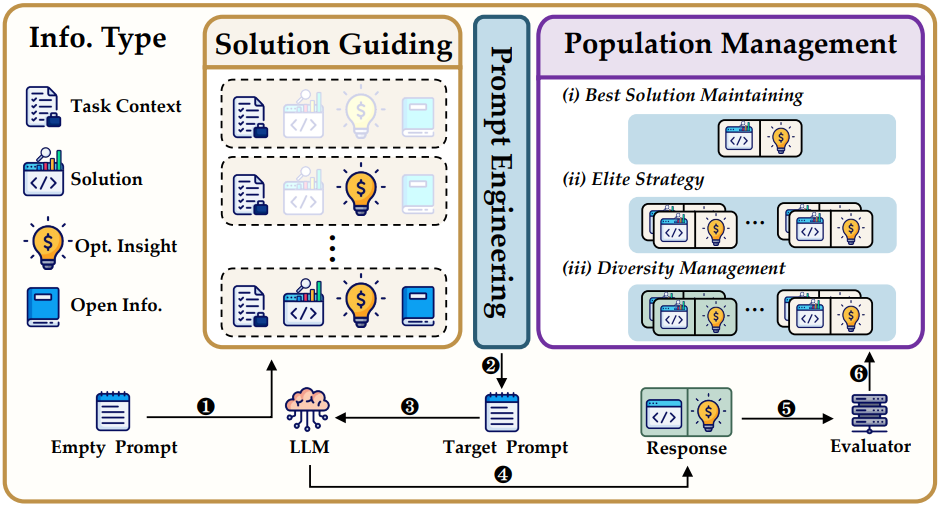

两层分解设计：
* Solution Guiding Layer(方案引导层): 决定向LLM提供什么信息，闭世界信息(任务上下文、历史高质量方案、优化见解)，开放世界信息(领域知识、检索增强方法)
* Prompt Engineer Layer(提示工程层): 将引导策略转化为具体提示词，处理提示结构、内容和格式

Population Management:
* 单方案策略: 仅维护当前最佳方案
* 精英保留策略: 保留少量高性能方案
* 多样性维护策略: 保持方案集合的探索能力

#### CudaForge: An Agent Framework with Hardware Feedback for CUDA Kernel Optimization  

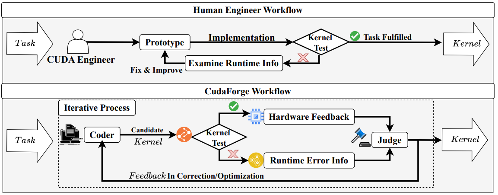

coder → kernel test(正确性验证) → Judge(←硬件反馈 NCU+GPU specs) → feedback(correction/optimization) → coder  
角色分离: Coder专注生成，Judge专注评估  
硬件感知: 显示集成NCU profiling指标  
轻量化记忆: 每轮只保留当前反馈，不保存完整对话历史  

---
关键发现:
* 全量NCU指标反而有害: Judge被过多冗余信号压垮 
* 双模式必要性: correction确保正确性，optimization驱动性能提升
* Agent分离 

#### STARK: Strategic Team of Agents for Refining Kernels

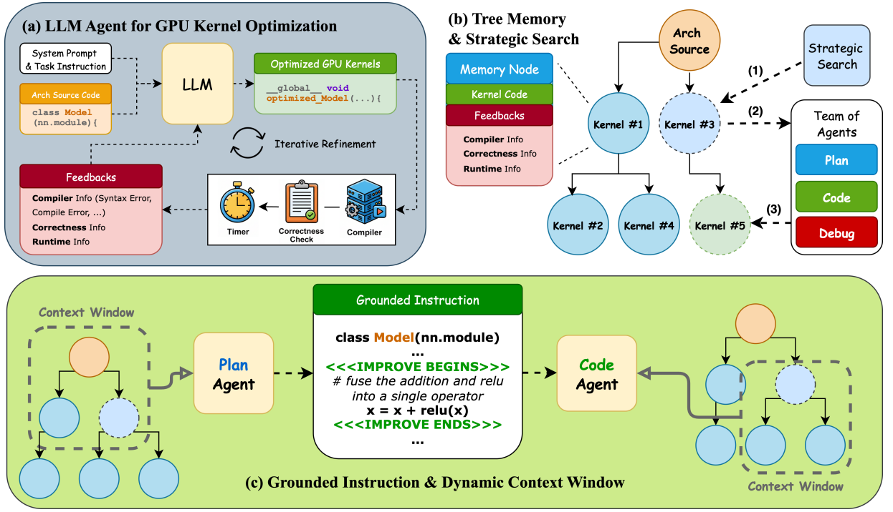

Plan Agent(t=0.8,高温度 → 创造性探索)
Code Agent(t=0.1,低温度 → 精确实现)
Debug Agent(t=0.1,修复编译/编译错误)

与其他方法的对比
| 方法 | 策略 | 问题
|---|---|---|
| Best-of-K | 独立采样K个候选 | 无反馈，浪费资源|
| Iterative Refinement | 仅基于最新候选 | 短视，容易陷入局部最优 |
| STARK | 树状记忆+战略搜索 | 反馈驱动+全局视野 |

动态上下文窗口
Plan Agent的上下文
W_plan(i) = {
    i,
    n_root,
    D(i),
    Top_r(C)
}
设计的目的:
1. 反思: 修正或叠加先前指令
2. 雄心校准: 顶级竞争者防止冗余探索
3. 能力估计: 根据Code Agent的表现调整指令复杂度

Code Agent的上下文
W_code(i) = {
    i, n_root,
    D(i),
    {j : p(j) ∈ S(i)}
}
关键洞察:
* 兄弟的子节点: 共享近乎相同的scaffold
* 成功的补丁: 在相近上下文中高概率迁移
* 避免重复错误

Debug Agent的上下文
W_debug(i) = {i, n_root, S(i)}
设计理由
1. 局部性： 大多数修复是结构性和局部的，off-by-one边界检查，步幅/索引对齐，共享内存大小调整
2. 避免干扰: 全局无关kerenl会降低精度

#### Astra: A Multi-Agent System for GPU Kernel Performance Optimization

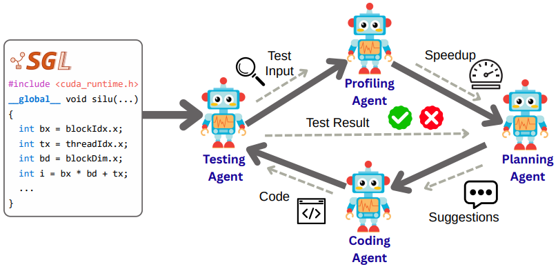

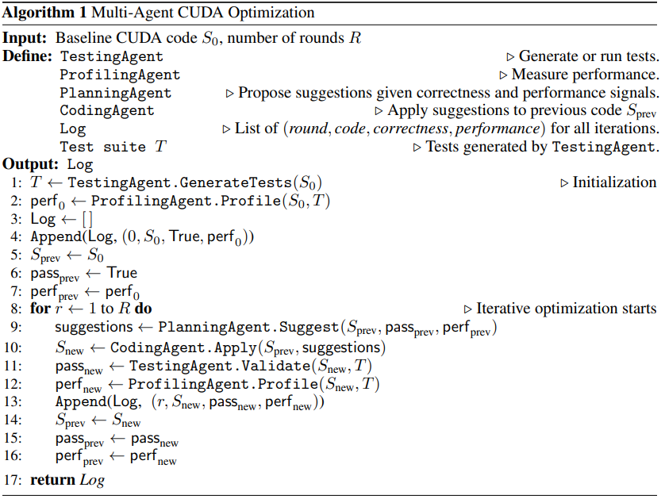

SGLang CUDA Kerenl (经过预处理提取的standalone的版本)  
↓  
Testing Agent (生成测试用例，验证正确性)  
↓  
Profiling Agent (测量执行时间，NSight Compute分析)  
↓  
Planning Agent (结合正确性+性能信号，提出针对性修改建议)  
↓  
Coding Agent (应用修改生成新Kernel)  
↓   
后处理:集成回SGLang  

---
Astra的论点
KernelBench 已经证明python → CUDA翻译对LLM非常困难  
专注于性能优化，避免翻译带来的错误和性能下降  
使用Nsight Compute但未详述如何筛选指标

#### KernelBand: Boosting LLM-based Kernel Optimization with a Hierarchical and Hardware-aware Multi-armed Bandit

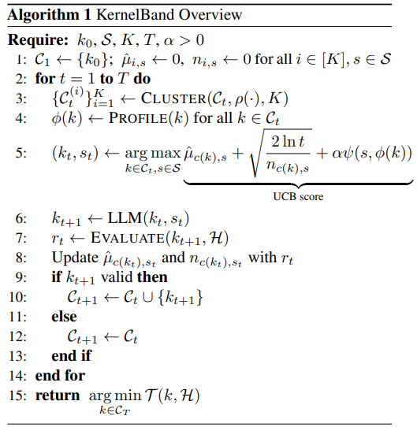

硬件特征提取  
L2_hit(L2缓存命中率)、mem_bw(内存带宽)、sm_util(SM利用率)、warp_eff(Warp效率)、acheieved_occupancy(实际占用率)、reg_per_thread(每线程寄存器)、shared_conflicts(共享内存冲突)、load_store_coalesced(访存合并)、tensor_core_util(TensorCore 利用率)

与STARK动态上下文窗口的对比：
||KernelBand|STARK|
|---|---|---|
|目标| 减少臂数量 | 构建Agent上下文 |
|方法| Runtime聚类 | 树关系 |
|特征| 6位Runtime | 代码结构 |
|效果| O(3\|s\|)臂 | Agent特定历史 |

#### PRAGMA: A Profiling-Reasoned Multi-Agent Framework for Automatic Kernel Optimization

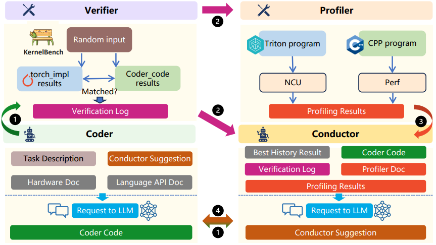

Conductor Agent: Coder生成的源代码、Verifier的错误日志和诊断信息、Profiler的性能分析数据和文档、历史最优版本及其性能数据
Coder Agent: 根据Conductor的指令生成内核实现，基于反馈进行增量修改，类似专家开发者的渐进式优化过程
Verifier Agent: 编译和运行生成的代码、对比参数输出验证正确性、记录编译或运行时的错误
Profiler Agent: 性能数据收集与解释

#### Swizzleperf: Hardware-aware llms for gpu kernel performance optimization

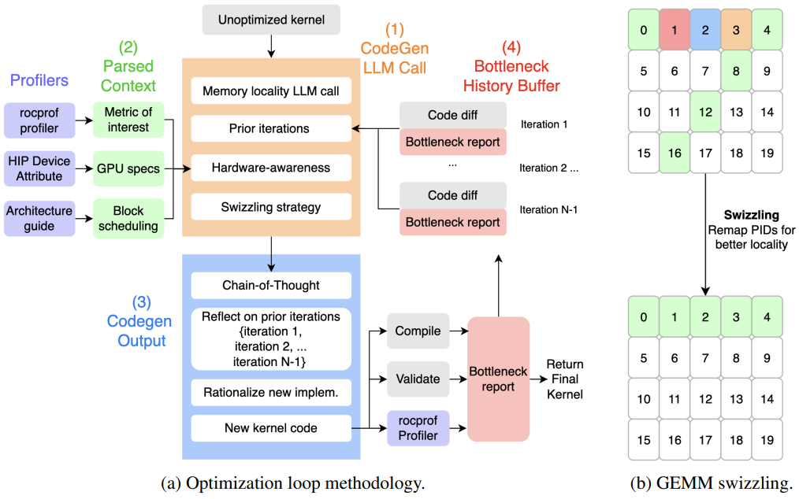

Swizzling是一种转换，重新排序数据或工作与其执行/存储位置之间的映射，以增强空间/时间局部性并与硬件拓扑对齐  

CodeGen LLM调用(代码生成)  
内核的简短内存局部性摘要，先前尝试的紧凑跟踪，架构细节(XCD数量、缓存大小、块调度策略)  

Parsed Context解析上下文  
rocprofv3: 提取瓶颈指标  
HIP设备属性: 收集GPU、XCD、缓存参数  
架构指南: 推导默认块调度策略  

CodeGen Output 代码生成输出  
编译新代码  
对照ground truth验证正确性  
运行rocprofv3获取更新的瓶颈报告  

Bottleneck History Buffer  
每次迭代附加代码差异和瓶颈报告  
后续调用可查看历史，反思失败  
按L2命中率(主要)排序候选方案 
保留最佳验证内核

#### AKG kernel Agent: A Multi-Agent Framework for Cross-Platform Kernel Synthesis

#### GPU Kernel Scientist: An LLM-Driven Framework for Iterative Kernel Optimization

#### cuPilot: A Strategy-Coordinated Multi-agent Framework for CUDA Kernel Evolution

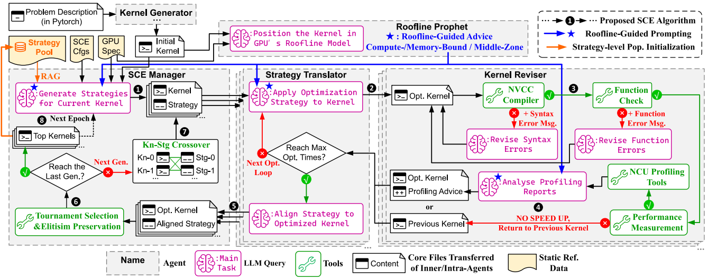

三维不匹配详解
交叉表示：传统交叉提示在代码层面操作，优化策略是隐式交叉的
后果: LLM 需要遍历跨越策略识别、策略组合和内核综合的扩展推理链
     导致无效优化
     丢弃先前获得的收益
     随着内核复杂度增长，问题加剧

适应度表示
适应度函数仅基于性能，与内核代码的语义相关性弱
后果: LLM 无法从众多性能分析报告中准确定位瓶颈
     导致琐碎的优化

种群初始化
问题: 初始种群由稀疏的内核代码集合表示
后果: 对整个优化策略空间的覆盖不足
     优化容易过早收敛到局部最优

#### PEAK: A Performance Engineering AI-Assistant for GPU Kernels Powered by Natural Language Transformations

#### GPU Kernel Optimization Beyond Full Builds: An LLM Framework with Minimal Executable Programs

#### Geak: Introducing Triton Kernel AI Agent & Evaluation Benchmarks

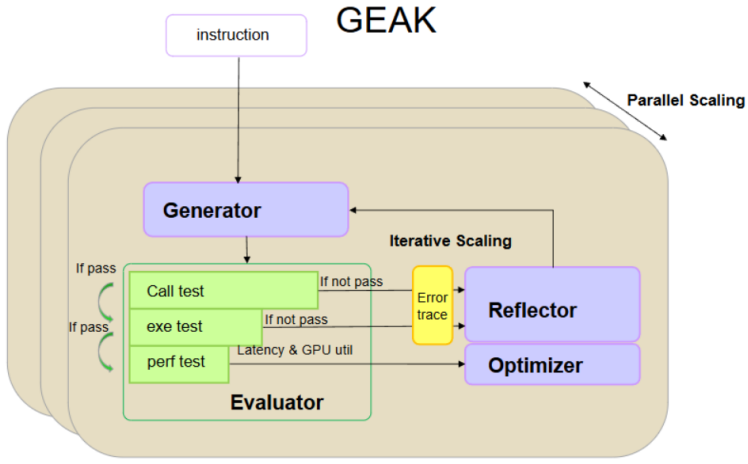

Generator(生成器): 基于用户查询和上下文信息生成代码，使用前沿LLM  
Evaluator(评估器): 级联设计(先测试功能正确性)、如果通过，再评估性能(延迟、内存效率)、如果失败，将错误追踪反馈给Reflector  
Reflector(反思器): 分析代码和错误追踪，识别潜在问题，基于Reflexion风格的反馈机制  
Optimizer(优化器): 基于历史生成记录和性能指标，识别优化方向，按性能升序排序历史记录以指导优化  

#### KForge: Program Synthesis for Diverse AI Hardware Accelerators

#### Towards Robust Agentic CUDA Kernel Benchmarking, Verification, and Optimization  
motivation:   
现有基准测试的漏洞: KernelBench等基准存在可悲利用的漏洞  
缺乏鲁棒验证: 现有方法只在单一配置下测试，无法评估真实泛化能力  
优化流程不完整: 缺乏端到端的自动化CUDA内核发现、验证和优化框架  

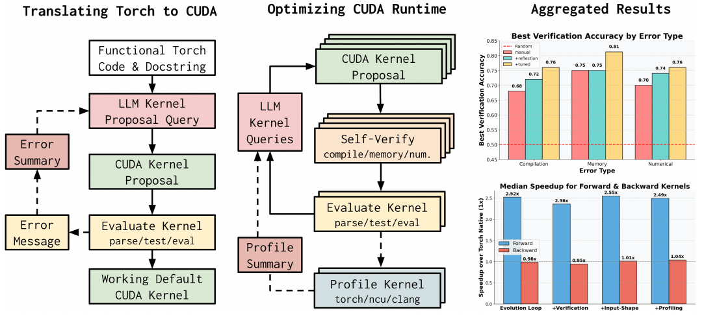

多配置测试: 支持不同输入形状、初始化状态、随机种子  
前向+方向测试: 首次支持backward pass 的内核优化评估  

消融实验  
模型集成影响:  
单模型 < 双模型 < 五模型集成  
多样性提升发现高性能内核的概率  

上下文构建策略  
5个least-to-most排序 > 10个随机 > 1个最佳  
渐进式示例帮助LLM学习优化模式  

性能分析反馈  
添加LLM总结的profiling信息显著提升性能  
帮助定位瓶颈并针对优化  

#### AccelOpt: A Self-Improving LLM Agentic System for AI Accelerator Kernel Optimization  

#### Optimizing PyTorch Inference with LLM-Based Multi-Agent Systems  

### AscendCraft: Automatic Ascend NPU Kernel Generation via DSL-Guided Transcompilation

你可以运行quick_start/tensorcore文件夹里面run.py,使用python run.py -p tensorcore -c gemm.json, 在gpu_tensorcore_operator.py文件会对各个阶段进行处理,例如gemm.json, 它有A B C阶段,经过处理后变成A A.shared A.shared.wmma.matrix_a B B.shared B.shared.wmma.matrix_b            
  dense.wmma.accumulator dense.wmma.accumulator.shared dense, 对每个阶段处理会产生相应的调度参数和相应的约束方程,然后在CGATuner类会求解约束方程得到各个调度参数的值,实际上只要确定env.task.knob_manager.candidates.keys()里面每个参数的值,就能确定其他相应参数的值,             
  然后我让你帮我写了一个ablation_study.py来分析每个阶段参数对最终性能的影响,但是我发现就是我在运行ablation_study.py得到每个stage的参数对性能影响的200组参数组合,每个组合性能的值都是为0, 你可以运行分析,请你帮我好好分析一下

请问一下就是Heron这个项目,我运行tests/quick_start/tensorcore/run.py,使用python run.py -p tensorcore -c gemm.json,我现在就是我在使用xgboost模型作为代价模型进行预测的时候,我在本地机rtx_3080上运行的时候发现比在服务器上rtx_4090上要快,主要快的时间是在xgboost模型进行训练时间上,同样的数据量在本地上更快,话说我这个Heron项目xgboost模型进行训练是不是只使用cpu,并没有使用gpu是吗,所以我在服务器rtx_4090上跑,虽然gpu性能好但是cpu差导致在本地上跑还要更快是吗,请你帮我分析一下

wmma_m": 16, "wmma_k": 16, "wmma_n": 16, "dense.wmma.accumulator_shared_pos": 3, "dense.wmma.accumulator_local_pos": 3, "dense_shared_pos": 1, "dense.wmma.accumulator.shared_local_pos": 0, "dense_unroll_pragma": 2, "densei.innertileSpatial": 1, "densej.innertileSpatial": 64, "densei.inner.innertileSpatial": 1, "densej.inner.innertileSpatial": 1, "densei.inner.inner.innertileSpatial": 4, "densej.inner.inner.innertileSpatial": 8, "dense_vectorize": 4, "densei.inner.inner.inner.innertileSpatial": 128, "densej.inner.inner.inner.innertileSpatial": 1, "dense.wmma.accumulator.shared_offset": 0, "dense.wmma.accumulator.shared_ax0": 1024, "dense.wmma.accumulator.shared_ax1": 16, "dense.wmma.accumulator.sharedax0tileSpatial": 1, "dense.wmma.accumulator.sharedax1tileSpatial": 1, "dense.wmma.accumulator_i.c": 1024, "dense.wmma.accumulator_j.c": 16,  "dense.wmma.accumulatori.ctileAll": 1, "dense.wmma.accumulatorj.ctileAll": 1, "dense.wmma.accumulatorktileAll": 4, "dense.wmma.accumulatori.c.innertileAll": 64, "dense.wmma.accumulatorj.c.innertileAll": 1, "dense.wmma.accumulatork.innertileAll": 1, "dense.wmma.accumulatori.c.inner.innertileAll": 1, "dense.wmma.accumulatorj.c.inner.innertileAll": 1, "dense.wmma.accumulatork.inner.innertileAll": 16, "B.shared.wmma.matrix_b_ax0": 16, "B.shared.wmma.matrix_b_ax1": 16, "B.shared_offset": 24, "B.shared_ax0": 16, "B.shared_ax1": 16, "B.shared_vectorize": 4，"A.shared.wmma.matrix_a_ax0": 16, "A.shared.wmma.matrix_a_ax1": 16, "A.shared_ax0": 16,"A.shared_ax1": 16, "A.shared_offset": 16, "A.shared_vectorize": 1,

"dense_i.outer": 1, "dense_i.inner": 1024, "dense_j.outer": 1, "dense_j.inner": 1024, 

"densei.innertileSpatial": 1, "dense_i.inner.outer": 1, "dense_i.inner.inner": 1024, "densej.innertileSpatial": 64, "dense_j.inner.outer": 64, "dense_j.inner.inner": 16, "blockIdx.x": 64, "dense_i.inner.outer.j.inner.outer.fused": 64, 

"densei.inner.innertileSpatial": 1, "dense_i.inner.inner.outer": 1, "dense_i.inner.inner.inner": 1024, "densej.inner.innertileSpatial": 1, "dense_j.inner.inner.outer": 1, "dense_j.inner.inner.inner": 16, "threadIdx.y": 1, "dense_i.inner.inner.outer.j.inner.inner.outer.fused": 1,

"densei.inner.inner.innertileSpatial": 4, "dense_i.inner.inner.inner.outer": 4, "dense_i.inner.inner.inner.inner": 256, "densej.inner.inner.innertileSpatial": 8, "dense_j.inner.inner.inner.outer": 8, "dense_j.inner.inner.inner.inner": 2, "threadIdx.x": 32, "dense_i.inner.inner.inner.outer.j.inner.inner.inner.outer.fused": 32,

"dense_vectorize": 4, 
"densei.inner.inner.inner.innertileSpatial": 128, "dense_i.inner.inner.inner.inner.outer": 128, "dense_i.inner.inner.inner.inner.inner": 2, "densej.inner.inner.inner.innertileSpatial": 1, "dense_j.inner.inner.inner.inner.outer": 1, "dense_j.inner.inner.inner.inner.inner": 2, "dense_i.inner.inner.inner.inner.inner.j.inner.inner.inner.inner.inner.fused": 4, 

"dense.wmma.accumulator.shared_ax0": 1024, "dense.wmma.accumulator.shared_ax1": 16, "dense.wmma.accumulator.shared_offset": 0, "dense.wmma.accumulator.shared_align_size": 16, 
"dense.wmma.accumulator.sharedax0tileSpatial": 1, "dense.wmma.accumulator.shared_ax0.outer": 1, "dense.wmma.accumulator.shared_ax0.inner": 1024, "dense.wmma.accumulator.sharedax1tileSpatial": 1, "dense.wmma.accumulator.shared_ax1.outer": 1, "dense.wmma.accumulator.shared_ax1.inner": 16, "dense.wmma.accumulator.shared_ax0.outer.ax1.outer.fused": 1, "dense.wmma.accumulator.shared_ax0.inner.outer": 64, "dense.wmma.accumulator.shared_ax0.inner.inner": 16, "dense.wmma.accumulator.shared_ax1.inner.outer": 1, "dense.wmma.accumulator.shared_ax1.inner.inner": 16, 

"dense.wmma.accumulator_i.c": 1024, "dense.wmma.accumulator_j.c": 16, 
"dense.wmma.accumulatori.ctileAll": 1, "dense.wmma.accumulator_i.c.outer": 1, "dense.wmma.accumulator_i.c.inner": 1024, "dense.wmma.accumulatorj.ctileAll": 1, "dense.wmma.accumulator_j.c.outer": 1, "dense.wmma.accumulator_j.c.inner": 16, "dense.wmma.accumulatorktileAll": 4, "dense.wmma.accumulator_k.outer": 4, "dense.wmma.accumulator_k.inner": 256, 
"dense.wmma.accumulatori.c.innertileAll": 64, "dense.wmma.accumulator_i.c.inner.outer": 64, "dense.wmma.accumulator_i.c.inner.inner": 16, "dense.wmma.accumulatorj.c.innertileAll": 1, "dense.wmma.accumulator_j.c.inner.outer": 1, "dense.wmma.accumulator_j.c.inner.inner": 16, "dense.wmma.accumulatork.innertileAll": 1, "dense.wmma.accumulator_k.inner.outer": 1, "dense.wmma.accumulator_k.inner.inner": 256, 
"dense.wmma.accumulatori.c.inner.innertileAll": 1, "dense.wmma.accumulator_i.c.inner.inner.outer": 1, "dense.wmma.accumulator_i.c.inner.inner.inner": 16, "dense.wmma.accumulatorj.c.inner.innertileAll": 1, "dense.wmma.accumulator_j.c.inner.inner.outer": 1, "dense.wmma.accumulator_j.c.inner.inner.inner": 16, "dense.wmma.accumulatork.inner.innertileAll": 16, "dense.wmma.accumulator_k.inner.inner.outer": 16, "dense.wmma.accumulator_k.inner.inner.inner": 16, "dense.wmma.accumulator_i.c.inner.inner.inner.outer": 1, "dense.wmma.accumulator_i.c.inner.inner.inner.inner": 16, "dense.wmma.accumulator_j.c.inner.inner.inner.outer": 1, "dense.wmma.accumulator_j.c.inner.inner.inner.inner": 16, "dense.wmma.accumulator_k.inner.inner.inner.outer": 1, "dense.wmma.accumulator_k.inner.inner.inner.inner": 16, 

"B.shared.wmma.matrix_b_ax0": 16, "B.shared.wmma.matrix_b_ax1": 16, 
"B.shared.wmma.matrix_b_ax0.outer": 1, "B.shared.wmma.matrix_b_ax0.inner": 16, "B.shared.wmma.matrix_b_ax1.outer": 1, "B.shared.wmma.matrix_b_ax1.inner": 16, 

"B.shared_ax0": 16, "B.shared_ax1": 16, "B.shared_offset": 24, "B.shared_ax0.ax1.fused": 256, "B.shared_vectorize": 4, 

"A.shared.wmma.matrix_a_ax0": 16, "A.shared.wmma.matrix_a_ax1": 16, "A.shared.wmma.matrix_a_ax0.outer": 1, "A.shared.wmma.matrix_a_ax0.inner": 16, "A.shared.wmma.matrix_a_ax1.outer": 1, "A.shared.wmma.matrix_a_ax1.inner": 16, "A.shared_ax0": 16,"A.shared_ax1": 16, "A.shared_offset": 16, "A.shared_align_size": 32, "A.shared_ax0.ax1.fused": 256, "A.shared_vectorize": 1,

  fused_outer_loop (bound = total_elements / vec / thread_x / thread_y)
    threadIdx.y loop (bound = threadIdx.y 的大小)
      threadIdx.x loop (bound = threadIdx.x 的大小 = warp × 32)
        vectorize loop (bound = vec_factor)

  L0_outer (bound = M / L0_tile)
    L1_outer (bound = L0_tile / L1_tile)
      L2_outer (bound = L1_tile / L2_tile)
        K_outer ...
          wmma_m inner (bound = wmma_m)

  - gridDim = (M / block_tile_m, N / block_tile_n)
  - blockDim.y = threadIdx.y 的大小（= threadIdx.y knob 的值）
  - blockDim.x = warp 数量 × 32（warp 内 32 个线程）
  - 总线程数 = blockDim.x × blockDim.y
for i.o, j.o in (1,1)
  for i.i.o, j.i.o in (1, 64, blockIdx.x)
    for i.i.i.o, j.i.i.o in (1, 1, threadIdx.y)
      for i.i.i.i.o, j.i.i.i.o in (4, 8, threadIdx.x)
         for i.i.i.i.o, j.i.i.i.o in (128, 1)
            vectorize(4)
对于dense.wmma.accumulator.shared阶段经过start、tileThread、tensorcoreStore
然后因为"dense_shared_pos": 1， 所以轴的长度ax0=1024, ax1=16,然后变换如下
for ax0.o, ax1.o in (1, 1)
  for ax.i.o, ax.i.i in (64, 1)
    wmma.store

对于dense.wmma.accumulator阶段经过start、generalTile、tensorcoreCompute
因为"dense.wmma.accumulator.shared_local_pos": 0, 所以轴的长i.c=1024， j.c=16, k=1024
for i.c.o, j.c.o, k.o in (1, 1, 4)
  for i.c.i.o, j.c.i.o, k.i.o in (64, 1, 1)
    for i.c.i.i.o, j.c.i.i.o, k.i.i.o in (1, 1, 16)
      for i.c.i.i.i.o, j.c.i.i.i.o, k.i.i.i.o in (1, 1, 1)
        wmma.compute

对于A.shared.wmma.accumulator.matrix_a阶段经过start、tensorcoreLoadA
因为"dense.wmma.accumulator_local_pos": 3, 所以轴的长ax0=16, ax1=16
for ax0.o ax1.o in (1, 1)
 wmma.load_matrix_a

对于A.shared阶段经过start、defaultSharedLoadSched
因为"dense.wmma.accumulator_shared_pos": 3, 所以轴的长ax0=16, ax1=16
for ax0.ax1.fused.o.o.o in (8)
  for ax0.ax1.fused.o.o.i in (1, threadIdx.y)
    for ax0.ax1.fused.o.i in (32, threadIdx.x)
      vectorize(1)

对于B.shared.wmma.accumulator.matrix_a阶段经过start、tensorcoreLoadB
因为"dense.wmma.accumulator_local_pos": 3, 所以轴的长ax0=16, ax1=16
for ax0.o ax1.o in (1, 1)
 wmma.load_matrix_b

对于B.shared阶段经过start、defaultSharedLoadSched
因为"dense.wmma.accumulator_shared_pos": 3, 所以轴的长ax0=16, ax1=16
for ax0.ax1.fused.o.o.o in (2)
  for ax0.ax1.fused.o.o.i in (1, threadIdx.y)
    for ax0.ax1.fused.o.i in (32, threadIdx.x)
      vectorize(4)

整理一下循环嵌套关系
for i.o, j.o in (1,1)
  for i.i.o, j.i.o in (1, 64, blockIdx.x)

    for ax0.o, ax1.o in (1, 1)

      for i.c.o, j.c.o, k.o in (1, 1, 4)
        for i.c.i.o, j.c.i.o, k.i.o in (64, 1, 1)
            for i.c.i.i.o, j.c.i.i.o, k.i.i.o in (1, 1, 16)
              for i.c.i.i.i.o, j.c.i.i.i.o, k.i.i.i.o in (1, 1, 1)

                for ax0.ax1.fused.o.o.o in (8)
                  for ax0.ax1.fused.o.o.i in (1, threadIdx.y)
                    for ax0.ax1.fused.o.i in (32, threadIdx.x)
                      vectorize(1)
                for ax0.ax1.fused.o.o.o in (2)
                  for ax0.ax1.fused.o.o.i in (1, threadIdx.y)
                    for ax0.ax1.fused.o.i in (32, threadIdx.x)
                      vectorize(4)
                for ax0.o ax1.o in (1, 1)
                  wmma.load_matrix_a
                for ax0.o ax1.o in (1, 1)
                  wmma.load_matrix_b
                wmma.compute

      for ax.i.o, ax.i.i in (64, 1)
        wmma.store
    for i.i.i.o, j.i.i.o in (1, 1, threadIdx.y)
      for i.i.i.i.o, j.i.i.i.o in (4, 8, threadIdx.x)
         for i.i.i.i.o, j.i.i.i.o in (128, 1)
            vectorize(4)
五个调度阶段的循环展开与性能符号

  Phase 1: LOAD_L2 — A.shared 从 Global 加载

  决定 A.shared 的尺寸由 compute_at_pos 确定：
    pos = 0~2 (k.o 层级): A_smem = block_m × k_inner × dtype_bytes
    pos = 3~5 (k.i.o 层级): A_smem = warp_tile_m × (k_inner/ty) × dtype_bytes
    pos = 6+  (wmma 层级): A_smem = wmma_m × wmma_k × dtype_bytes

  A.shared 加载的循环展开（实际循环长度）：
    fused_total = A_smem / dtype_bytes  （总元素数）
    outer_A = ceil(fused_total / (ty × 32 × vec_A))

    for outer_A:
      for ty:         ← threadIdx.y
        for 32:       ← threadIdx.x
          vectorize(vec_A)

  符号 S_load_A:
    coalesce_bytes = vec_A × dtype_bytes           （每线程每次加载的字节数）
    ideal_bytes = 16                               （128-bit = 16 bytes，最优）
    P_load_A = min(coalesce_bytes / ideal_bytes, 1.0) = min(vec_A × 2 / 16, 1.0)

    有效线程数: effective_threads = min(fused_total / vec_A, ty × 32)
    thread_util_A = effective_threads / (ty × 32)  （线程利用率）

  Phase 2: LOAD_L2 — B.shared 从 Global 加载

  B.shared 尺寸（与 A.shared 类似，但是 N 方向）：
    pos = 0~2: B_smem = block_n × k_inner × dtype_bytes
    pos = 6+:  B_smem = wmma_n × wmma_k × dtype_bytes

  outer_B = ceil(B_smem / (dtype_bytes × ty × 32 × vec_B))

  符号 S_load_B:
    P_load_B = min(vec_B × 2 / 16, 1.0)
    thread_util_B = min(B_smem/vec_B/dtype_bytes, ty×32) / (ty×32)

  Phase 3: COMPUTE — wmma.mma.sync 循环嵌套

  实际循环展开（四层）：
    for k.o in (k_outer):                          ← k_outer = root_K / k_inner
      for i.c.i.o in (i_wmma_ops):                 ← i_wmma_ops = warp_tile_m / wmma_m
        for k.i.i.o in (k_wmma_ops):               ← k_wmma_ops = k_inner / wmma_k
          for j.c.i.o in (j_wmma_ops):             ← j_wmma_ops = warp_tile_n / wmma_n
            wmma.compute

  符号 S_compute:
    total_smem = A_smem + B_smem + C_smem（C_smem 由 store compute_at_pos 决定）

    blocks_by_smem = floor(smem_limit / total_smem)
    blocks_by_warp = floor(max_warps_per_SM / ty)
    blocks_per_SM = min(blocks_by_smem, blocks_by_warp, max_blocks_per_SM)

    P_occupancy = (blocks_per_SM × ty) / max_warps_per_SM

    wmma_align_m = (warp_tile_m % wmma_m == 0)  → 1.0 or 0.3
    wmma_align_n = (warp_tile_n % wmma_n == 0)  → 1.0 or 0.3
    P_align = wmma_align_m × wmma_align_n

  Phase 4: STORE_L1 — wmma → dense.wmma.accumulator.shared

  wmma.store 的循环展开：
    for ax0.o in (block_m/wmma_m / ty):
      for ax1.o in (block_n/wmma_n):
        wmma.store

  C_smem = block_m × block_n × out_dtype_bytes（if dense_shared_pos is low）
        OR wmma_m × wmma_n × out_dtype_bytes（if dense_shared_pos is high）

  P_store_L1 = 1.0（wmma.store 通常不是瓶颈，wmma 自动保证对齐）

  Phase 5: STORE_L2 — dense 阶段输出到 Global

  输出写回循环展开（dense 的 threadIdx.y, threadIdx.x, vectorize 层）：
    for ty:
      for tx (4 or 8):
        vectorize(vec_output)

  P_store_L2 = min(vec_output × out_dtype_bytes / 16, 1.0)

                        AMOS
GEMM  1024, 1024, 1024 0.138515 ms

